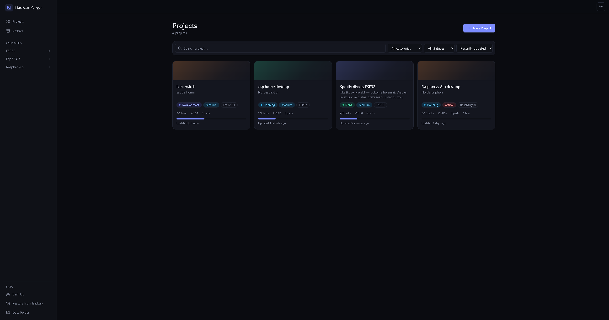
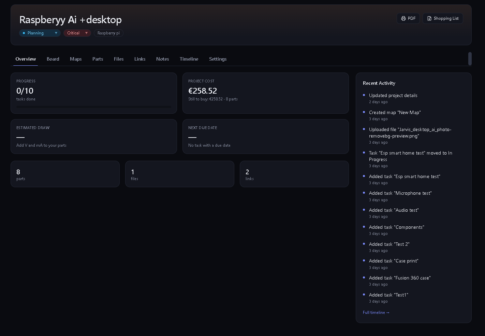
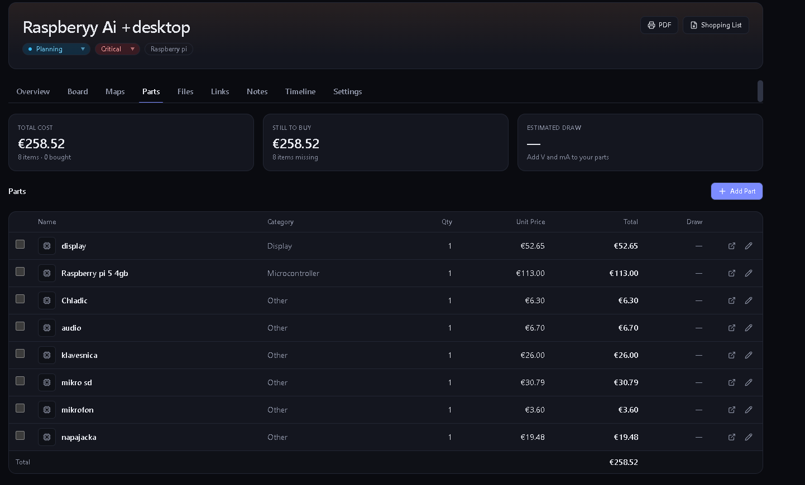
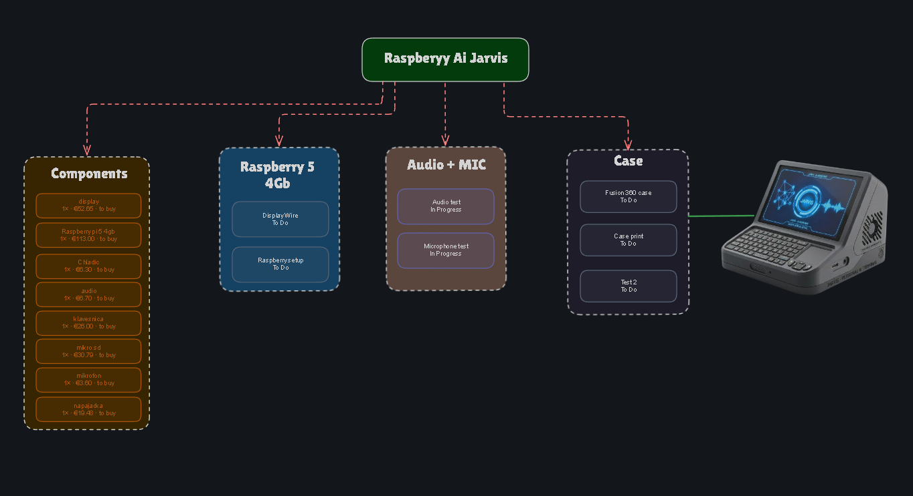

# HardwareForge

A planner for hardware projects — ESP32, Arduino, 3D printing, electronics.

**Free. Open-source. Fully offline.** Everything you create — projects, files,
photos, drawings — stays on your own computer. The app never connects to the
internet, not even to check for updates.

## Screenshots

**Your projects at a glance**



**Project overview — progress, cost, and recent activity**



**Parts list with prices and shopping totals**



**Maps — free-form canvas linked to your tasks and parts**



## Download

1. Go to the **[Releases page](../../releases/latest)**.
2. Under **Assets**, click **`HardwareForge-Setup-x.y.z.exe`** to download it
   (the numbers are the version — just click the `.exe` file).
3. Open the downloaded file.
4. Windows will show a blue **"Windows protected your PC"** screen. This is
   normal — it just means the app isn't from a big company that paid for a
   certificate yet. Click the small **More info** link, then click the
   **Run anyway** button that appears.
5. Click through the installer (no admin password needed). When it finishes,
   HardwareForge opens by itself.

That's it — no account, no sign-up, no credit card, nothing to configure.

## What it does

| Section | What's in it |
|---|---|
| **Projects** | A list of all your projects, with search and filters |
| **Board** | A Kanban board (drag cards between To Do / In Progress / Done...) |
| **Maps** | A free-form canvas for sketches, wiring diagrams, and photos |
| **Parts** | Track components, prices, and links to the shop you bought them from |
| **Files** | Store PDFs, STL/STEP 3D models, images, ZIPs — up to 100 MB each |
| **Links, Notes** | Save datasheets and websites; write notes with checklists |
| **Timeline** | See the full history of everything you changed |

Also included: export a project as a PDF, export a shopping list as a
spreadsheet (CSV), and a light/dark theme.

## Where is my data?

Everything is saved in one folder on your computer:
`%APPDATA%\HardwareForge\data\`

Inside the app, click **File → Open Data Folder** to open it directly.

- **Back up your data:** **File → Back Up Data…** This saves everything into
  a single `.zip` file. Keep a copy somewhere else too (a USB stick, a cloud
  drive) in case your computer breaks.
- **Restore from a backup:** **File → Restore from Backup…** Your current
  data is not deleted — it's moved aside first, just in case.
- **Uninstalling the app does NOT delete your data.** Your projects stay on
  your computer even after uninstalling. Delete the folder above yourself if
  you want to remove them too.

## Updates

HardwareForge never goes online by itself, so it can't check for updates
automatically. To get a newer version: download it from the
[Releases page](../../releases/latest) and install it the same way as before
— your existing projects are kept.

## Is it safe?

Yes. There are no accounts, no ads, no analytics, and no tracking of any
kind. The app is blocked from making any internet connection at all — it
technically cannot send your data anywhere. Full technical details are in
[SECURITY.md](SECURITY.md).

## Questions or problems?

Open an [issue](../../issues) and describe what happened — screenshots help.

---

## For developers

```bash
npm install       # installs dependencies + Prisma client + editor fonts
npm run dev       # runs the app in a browser at http://127.0.0.1:3000 (data in ./.data)
npm test          # unit + integration tests
npm run electron  # runs the app in an Electron window
npm run dist       # builds the Windows installer into release/
```

To change the database schema: edit `prisma/schema.prisma`, then run
`npm run db:migration -- name_of_change`. The app applies new migrations
automatically on next launch (backing up the database first).

License: [MIT](LICENSE).
